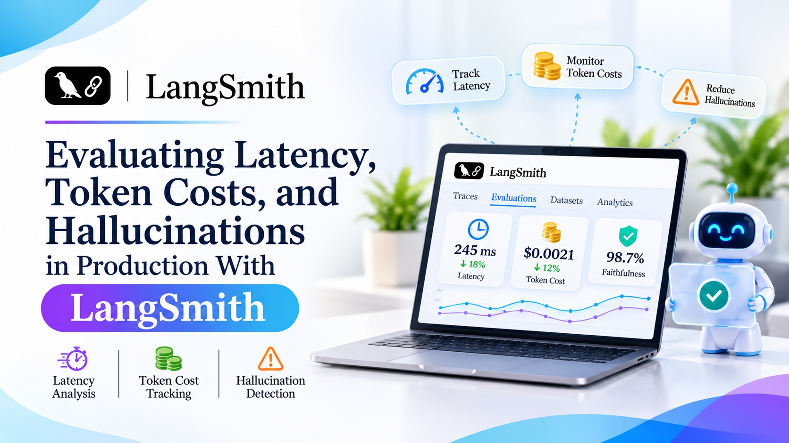

# Evaluating Latency, Token Costs, and Hallucinations in Production With LangSmith



A demo has one user and one happy path. Production has thousands of users, messy inputs, slow days, and a monthly bill. The question changes from "does it work?" to "how fast, how expensive, and how often is it wrong?" Teams that cannot answer those three questions with numbers are running on hope.

Teams that want [production-ready LLM orchestration solutions](https://zignuts.com/ai-services/ai-integration/langchain-integration-services?utm_source=seo_web2.0&utm_medium=backlink&utm_campaign=seo_referral&utm_id=11) treat measurement as part of the architecture, not an afterthought. Every step is traced, every change is scored, and every release has to pass a quality gate first.

## The Metrics That Matter

| Area | Measure | Why it matters |
|---|---|---|
| **Latency** | End-to-end time, time to first token, p50, p95, p99 | Averages hide the slow requests users remember |
| **Latency by step** | Retrieval, reranking, model call, tool calls | Shows which step to fix first |
| **Token cost** | Input tokens, output tokens, cost per task | Cost scales with usage and prompt size |
| **Hallucination** | Groundedness, citation correctness, unsupported claim rate | Wrong answers erode trust fastest |
| **Abstention** | Rate of correct "I do not know" answers | Declining beats inventing |
| **Errors and retries** | Failures, timeouts, rate limits, retry counts | Hidden retries inflate cost and delay |

Track the three headline areas together. A change that cuts cost but raises the hallucination rate is not an improvement.

## Tracing Setup

```bash
# Environment (names can change between versions)
LANGSMITH_TRACING=true
LANGSMITH_API_KEY=<your key>
LANGSMITH_PROJECT=support-assistant-prod
```

```python
from langsmith import traceable

@traceable(name="answer_question")
def answer_question(question: str, user_id: str):
    docs = retrieve(question)
    return generate(question, docs)
```

SDK names and settings change between releases. Check the current LangSmith documentation before you build.

## Offline Evaluation Checklist

- [ ] Real questions collected from traces and support logs
- [ ] Reference answers or expected sources recorded
- [ ] Hard cases included: ambiguous, missing evidence, past failures
- [ ] Code checks, model-based judges, and human review combined
- [ ] Quality, latency, and cost compared side by side for every candidate
- [ ] Judges calibrated against human-labeled samples

## Online Evaluation

- [ ] Groundedness scored on a sample of live answers
- [ ] User feedback linked to the trace
- [ ] Failed and slow traces collected into a review queue
- [ ] Reviewed failures added to the golden dataset
- [ ] Same dataset re-scored on a schedule to detect drift

## Alert Signals

| Signal | Alert when | Typical response |
|---|---|---|
| p95 latency | It rises beyond your agreed target | Inspect the slowest step |
| Cost per task | It climbs faster than usage | Check prompt length, retries, model choice |
| Groundedness | It falls below your baseline | Review retrieval and recent prompt changes |
| Error rate | Failures or timeouts spike | Check provider status and fallbacks |
| Daily spend | A team or tenant exceeds budget | Throttle, cap, or investigate |

Set targets from your own baseline rather than copying numbers from other teams.

## Debugging Workflow

1. **Find the trace** from the complaint, alert, or low-scored run.
2. **Read each step**, checking retrieved documents before blaming the model.
3. **Classify the cause:** retrieval miss, prompt issue, model behavior, or tool failure.
4. **Fix one thing** so the effect is clear.
5. **Re-run the dataset** to confirm quality, latency, and cost.
6. **Add the case** to the dataset so it never returns unnoticed.

## Get Started

Ready to put numbers behind your LLM application? Visit [zignuts.com](https://zignuts.com/) to speak with the team.

## Publish with GitHub Pages

1. Add `langchain-langsmith-production-pipeline.jpg` to the repository root.
2. Go to **Settings > Pages**, choose the `main` branch and the `/ (root)` folder, then save.
3. The site will be available at `https://harshp-zigs.github.io/langchain-enterprise-agent-orchestrator/`.

## Topics

`langsmith` `langchain` `llm-evaluation` `llm-observability` `token-cost` `latency` `hallucination-detection`
